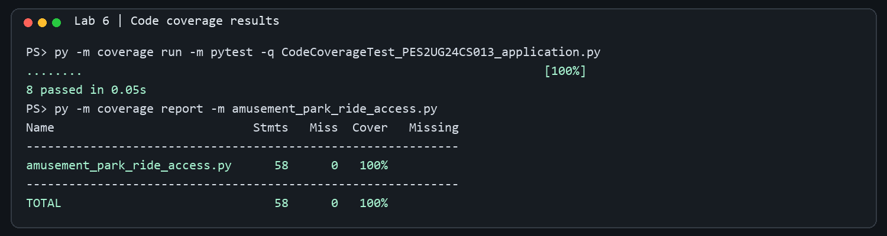
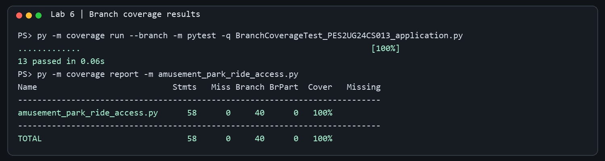

# L6_L7_11 - Amusement Park Ride Access

Lab 6: Code and Branch Coverage

**Student SRN:** PES2UG24CS013

## Application and starter files

- `amusement_park_ride_access.py` - application under test
- `test_amusement_park.py` - original starter tests
- `CodeCoverageTest_PES2UG24CS013_application.py` - code coverage test suite
- `BranchCoverageTest_PES2UG24CS013_application.py` - branch coverage test suite

## Results

Both suites pass and report 100% coverage for the application module. The branch report covers all 40 branches.

### Code coverage

Command: `py -m coverage run -m pytest -q CodeCoverageTest_PES2UG24CS013_application.py`



### Branch coverage

Command: `py -m coverage run --branch -m pytest -q BranchCoverageTest_PES2UG24CS013_application.py`



To reproduce either report, run its command from this folder, followed by:

```powershell
py -m coverage report -m amusement_park_ride_access.py
```

The repository's `Lab 6` folder contains the Lab 6 materials; keep any later Lab 7 work separate as directed by the starter README.
